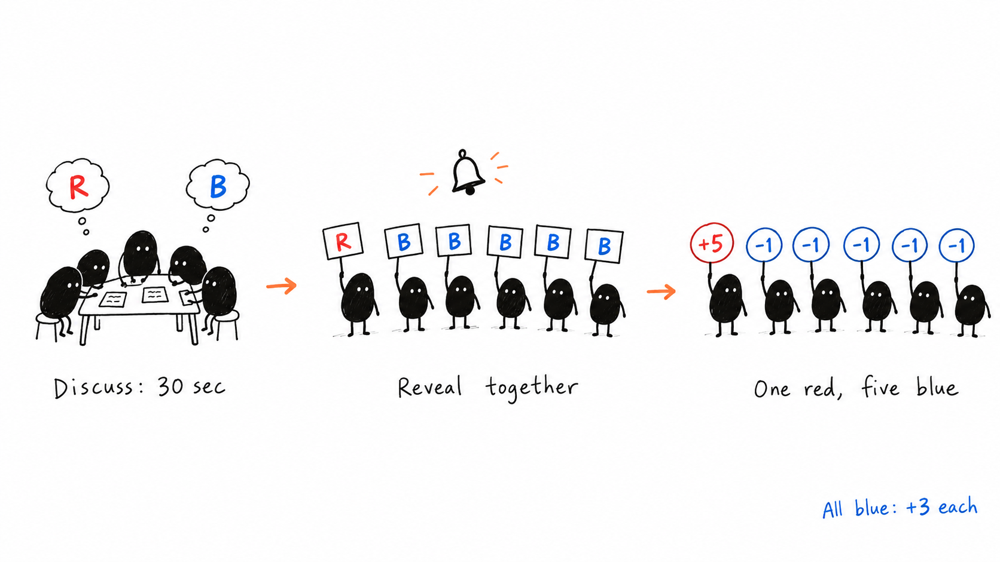
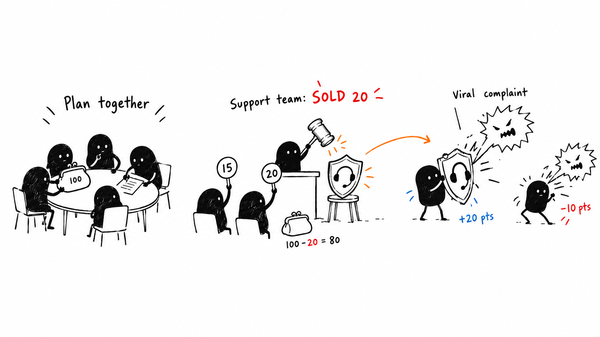

# Two classroom games: a facilitator walkthrough

For six groups of five students, seated at their own tables. This guide explains the games before choosing what to build. The original handoff remains unchanged. Nothing has been deployed.

## 1. Red or Blue

### What the game feels like

Each group makes one small decision: red or blue. Their score depends on what all the other groups choose. A group can gain by choosing red while everyone else chooses blue, but if everyone chooses red, everyone loses points. The discussion afterwards is about trust and how people interpret a shared goal.

This is a round-based game with simultaneous choices. Teams must not take turns revealing their colours: later teams would have extra information.

### Explain it to the room

Say: “Your task is to score as many points as you can. Each round, discuss within your group and choose red or blue. Keep your decision private until I count down. All groups reveal together.”

Show the scoring table from the start. Do not explain the cooperation lesson or the all-blue benchmark until the debrief. This illustrated guide is for the facilitator; it contains spoilers.

### Scoring adapted for six groups

The source table is for five groups. The following extends its stated pattern to six: in a mixed round, each red group gains one point per blue group, and each blue group loses one point per red group. Keep the original special outcomes for unanimous choices.

| Number choosing red | Each red group | Each blue group |
| --- | --- | --- |
| 0 | — | +3 |
| 1 | +5 | −1 |
| 2 | +4 | −2 |
| 3 | +3 | −3 |
| 4 | +2 | −4 |
| 5 | +1 | −5 |
| 6 | −2 | — |

### Walk through two rounds

**Round 1:** Give groups 30 seconds to discuss. Count down: “Three, two, one, show.” All six groups choose blue, so each earns 3 points.

**Round 2:** Group A chooses red; the other five choose blue. Group A gains 5 points. Each other group loses 1 point.

| Group | After round 1 | Round 2 change | Running total |
| --- | --- | --- | --- |
| A | 3 | +5 | 8 |
| B | 3 | −1 | 2 |
| C | 3 | −1 | 2 |
| D | 3 | −1 | 2 |
| E | 3 | −1 | 2 |
| F | 3 | −1 | 2 |

Now ask yourself what the groups might do next. Will the others copy A? Will they trust a promise to choose blue? That uncertainty creates the activity.

### What you actually do as facilitator

1. Explain the scoring and practise the reveal once without points.
2. Start a 30-second discussion timer.
3. Count down and have everyone reveal at once.
4. Record all six choices, then show the new scores.
5. Repeat for eight rounds. Rounds 4, 6 and 8 multiply that round’s points by 2, 3 and 5 respectively, including negative points.
6. Before each bonus round, allow one minute of negotiation between groups. One spokesperson per group speaks from their seat. Otherwise, groups discuss only internally.
7. End with a discussion of the decisions, rather than only announcing a winner.

Budget about 20–25 minutes including explanation and debrief. The timed decisions themselves are short; leave time to record results and let students react.

### Can students play without devices or paper?

Yes. Use a closed fist for red and an open palm for blue. One spokesperson per group holds the agreed signal until you have recorded all six. Reveal on the same countdown. Rotating the spokesperson each round gives more members a speaking role.

The app would replace your timer, scoring table and whiteboard. It would not collect secret choices from students in this version. You would click R or B for each group after the simultaneous reveal, then confirm the round. An undo function would let you correct an entry.

### Debrief

- “Did ‘score as many points as you can’ mean your group or the whole class?”
- “What changed after someone first chose red?”
- “Did any promise influence your next decision?”
- “Where could this happen between departments in an organisation?”

With the proposed six-group rules, all-blue play throughout gives each group 45 points and the class 270 points. That is a comparison for the final discussion, not an opening instruction.

### Suitability

This is the easier game to facilitate. It needs little preparation and naturally produces a discussion about cooperation. Its connection to organisational planning is less direct than the Auction’s, and the facilitator needs to explain the scoring clearly.

## 2. The Auction

### What the game feels like

Each group runs an imaginary startup with 100 credits. You auction resources one at a time. Groups decide what they need and how much they are willing to pay. Afterwards, five business events test what they bought.

The credits are game money. Students do not pay real money. They stay seated and bid aloud.

### Explain it to the room

Say: “Your group is a startup with 100 credits. Buy resources that will help your company survive its first year. You cannot buy everything, and you cannot spend more than you have. Discuss your priorities and your maximum prices before bidding.”

Show the full list of 12 resources and give three minutes to plan:

Cybersecurity audit; Senior developer; Legal advisor; Compliance software; Customer support team; PR agency; Staff benefits package; Training programme; Cash reserve; Marketing campaign; Luxury office; Company cars.

Give the source’s forecast hints: customers complain loudly online, data protection rules may change, and competitors are poaching talent. The original version keeps the event list and point values hidden until the end. This guide explains those hidden rules to you as facilitator.

### Walk through one sale

You announce: “Customer support team. Opening bid: 5 credits.”

- Group B: “Five!”
- Group D: “Ten!”
- Group B: “Fifteen!”
- Group A: “Twenty!”
- You: “Twenty with Group A. Going once… going twice… sold.”

You record Group A as the buyer at 20 credits. Its budget falls from 100 to 80, and Customer support team joins its inventory. The app can do both automatically when you confirm the sale.

Only one spokesperson per group bids at a time. Everyone else helps that person decide whether to continue. Bidding is open between groups; it is not a strict A–B–C turn order.

### What you actually do as facilitator

1. Enter or load the six group names. Give each group 100 credits.
2. Show all resources and forecast hints. Start the three-minute planning timer.
3. Open the first resource at 5 credits. Accept bids in increments of 5.
4. Acknowledge the leading group and price aloud. Confirm the final winner and sale amount.
5. Repeat for each resource. Sell each resource only once.
6. After the sixth sale, announce: “Rumours of a price war next quarter.” Allow a short discussion before continuing.
7. After the auction, reveal the five events individually. Show how each group’s purchases affect its score.
8. Add the remaining-credit bonus and discuss the decisions.

Aim for roughly 45–60 seconds per resource, then allow time for explanation, planning, the news flash, event reveals and debrief. About 20–25 minutes is a target; it depends on how quickly you close bidding.

### What happens after the auction?

| Event | Either of these resources protects the group |
| --- | --- |
| Data breach attempt | Cybersecurity audit OR Senior developer |
| New data protection law | Legal advisor OR Compliance software |
| Viral customer complaint | Customer support team OR PR agency |
| Competitor poaches staff | Staff benefits package OR Training programme |
| Price war | Cash reserve OR Marketing campaign |

For each event, a protected group gets +20; an unprotected group gets −10. Two resources covering the same event still earn only +20 for that event. Luxury office and Company cars protect against no listed event in this game.

“Cash reserve” is the name of an auction resource. In the source rules, simply retaining unspent credits does not protect a team against the price war; unspent credits receive a separate final bonus.

### A complete scoring example

Suppose Group A bought Customer support team for 20 and Legal advisor for 25. It has 55 credits left.

| Event | Group A’s result | Points |
| --- | --- | --- |
| Data breach | No matching resource | −10 |
| New law | Legal advisor protects it | +20 |
| Customer complaint | Customer support protects it | +20 |
| Staff poaching | No matching resource | −10 |
| Price war | No matching resource | −10 |
| Event subtotal | | 10 |
| Remaining-credit bonus | 5 complete sets of 10 credits | +5 |
| Final score | | **15** |

This example rounds the credit bonus down: 55 credits gives 5 points. The original wording does not specify rounding, so this should be an explicit rule if we build the app.

### Small facilitation decisions to settle before building

- **Participation:** The source rotates bidders every three resources, which creates only four bidding slots for five members. A proposed change is to rotate every resource; over 12 resources, each member bids two or three times.
- **No bids:** Proposed rule: if nobody bids 5 credits, skip the resource without assigning it.
- **Simultaneous bids:** Proposed rule: the first bid you acknowledge becomes the current bid; another group must raise by 5.
- **Overspending:** The app should refuse a sale that exceeds the buyer’s remaining budget.
- **Ties:** Proposed rule: equal final scores share the win. The discussion remains the main learning outcome.
- **Scoring transparency:** We can retain the source’s hidden scoring. An alternative is to announce +20/−10 and the credit bonus upfront while keeping the exact events hidden, making the strategic task clearer. This would be a deliberate change.

### Debrief

- “What was your plan, and when did it change?”
- “Which purchase was useful, and which was expensive for what it provided?”
- “How did the price-war news affect your bidding?”
- “Who set your maximum price, and did the bidder follow it?”
- “Did buying a second resource for the same risk leave another risk uncovered?”

### Suitability

This gives a more concrete organisational strategy exercise, but you have more to manage. A facilitator app removes most bookkeeping: group budgets, inventories, sale records and event scoring. You still run the auction aloud and decide when to close bidding.

## What the first app could contain

No student accounts or joining flow are necessary for a facilitator-only version. Students play together at their tables; you operate one laptop, ideally connected to a projector.

| Red or Blue | The Auction |
| --- | --- |
| Editable group names and number of groups | Editable group names and starting credits |
| Discussion and negotiation timers | Planning timer and forecast display |
| Six colour entries per round by default | Current resource, buyer and sale-price entry |
| Automatic scores and bonus multipliers | Automatic budget deductions and inventory |
| Round history and undo | Sale history and correction controls |
| Final class total and debrief prompts | News-flash cue and event-by-event scoring |

The six-group Red or Blue scoring above must be confirmed as our adapted rule. For other group counts, the app would need a clearly defined scoring rule rather than silently reuse the six-group table.

A classroom display should show only information appropriate to the current stage. Debrief spoilers and unrevealed auction events should stay off the projected view. With only one projected screen, the app can defer showing them entirely until the relevant stage; a separate facilitator notes view is optional.

**Suggested starting point:** understand the games using this guide, then review a local facilitator-only Auction mockup if its budgeting and resource decisions fit the lesson you want. Red or Blue is a simpler alternative when ease of facilitation matters most.
