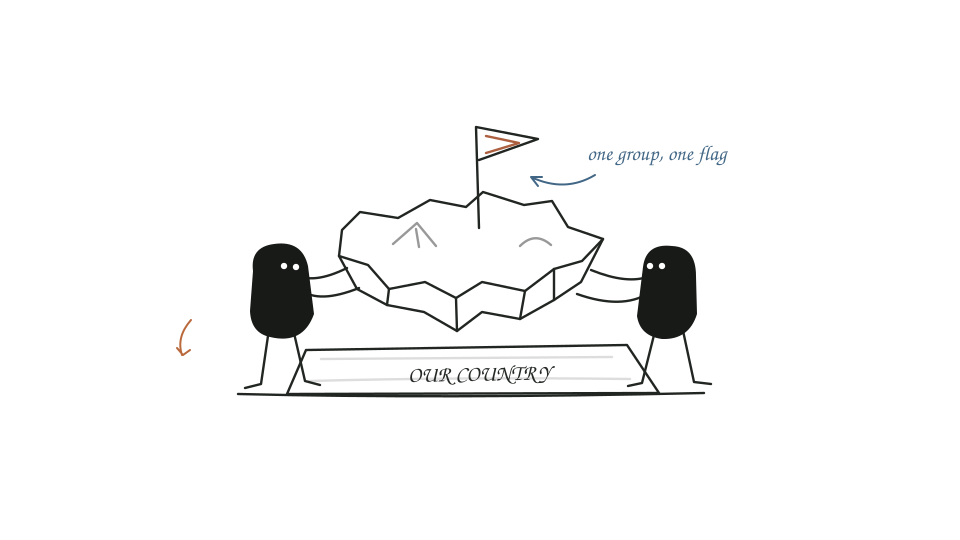
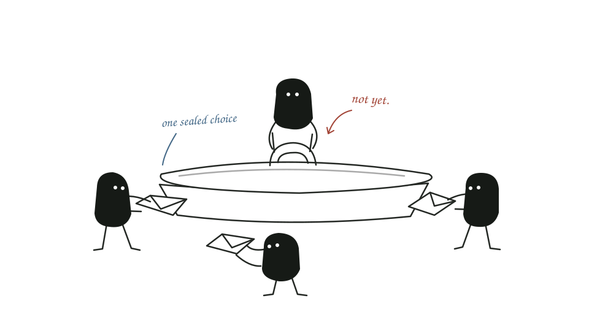
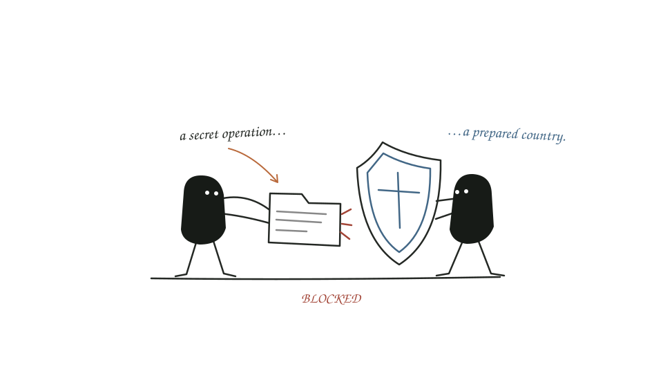

# The Summit — how to play

**Rules draft v1 · for review, not a built game or a playtested balance claim.**

A short diplomacy game for seated classroom groups. Each group leads a fictional country. Talk, make promises, choose one action, and discover who kept their word.

This draft deliberately simplifies the earlier concept: **one score, four actions, six rounds**. World events, separate intelligence missions, armies and territory capture are not part of the base game.

## Player guide — reusable app copy

### 1. Your group is a country

Choose a country name and a spokesperson. Every country starts with **10 Prestige**. Play **six rounds**. The country with the highest Prestige at the end wins.

Prestige is your only score. There is no money to manage, no army to move, and no elimination. Scores may fall below zero, but every country keeps playing.

The fictional map identifies the countries. **Distance, borders and island size do not change the rules. You can target or trade with any other country.**

### 2. Talk first. Commit together.

Each round has three stages:

1. **Negotiate — 90 seconds.** Discuss your plan, offer a trade, ask for protection through non-aggression promises, or bluff. Countries stay at their tables. One spokesperson per country speaks to other countries; everyone may discuss within their own group.
2. **Commit — 30 seconds.** Secretly write one action and, if needed, its target. Example: `Trade → Brume`. Submit your choice face down. Once submitted, it cannot change.
3. **Reveal and resolve.** After every country has submitted, the facilitator reveals the choices one at a time, then applies the round's results together. The order of the reveals gives nobody an advantage.

Promises are not binding. The submitted action is what counts. You may bluff during negotiation, but you may not change your action after submission.

Rotate the spokesperson each round. This changes who speaks, not who owns the decision: the whole group still agrees on its action.

### 3. Choose one of four actions

| Action | Your choice | Result |
| --- | --- | --- |
| **Develop** | No target | Gain **2 Prestige**. You can still be affected by espionage. |
| **Trade** | Choose one other country | If you both choose Trade with each other, each gains **3 Prestige**. Otherwise your trade earns **0**. |
| **Espionage** | Choose one other country | If they did not Defend, gain **1 Prestige** and give them an espionage penalty of **−2**. If they Defended, your operation earns **0** and does no damage. |
| **Defend** | No target | Gain **1 Prestige** and block **all espionage** against your country this round. |

**One choice means one choice.** You cannot Develop and Defend, or Trade and carry out Espionage, in the same round. You cannot target yourself.

**Trade must be mutual.** A trading with B while B trades with C is not a deal. A country can have only one trade partner in a round.

**Espionage damage is capped.** A country loses at most **2 Prestige from espionage in a round**, even when several countries target it. Every unblocked attacker still earns its own 1 Prestige. These are separate action rewards and penalties, not a transfer of a fixed pile of points.

**Combine your result with any penalty.** Develop gives +2; if you are also hit by espionage, −2 makes your net change 0. A successful trade hit by espionage gives +3 −2 = +1. Defend blocks the penalty entirely.

Espionage is a fictional game action, represented by an intercepted dossier or an unrest marker. There are no real-world operational instructions or separate riot mechanics to learn.

### 4. See one full round

All six countries begin this example with 10 Prestige. The choices below were made secretly before any were revealed.

| Country | Submitted action | What happened | Change | New Prestige |
| --- | --- | --- | --- | --- |
| Aster | Trade → Brume | Brume chose Aster too. | +3 | 13 |
| Brume | Trade → Aster | Their agreement held. | +3 | 13 |
| Cinder | Espionage → Dorne | Dorne defended. Operation blocked. | 0 | 10 |
| Dorne | Defend | Gains its defence point and blocks Cinder. | +1 | 11 |
| Estra | Develop | Gains 2, loses 2 to Fjord's operation. | 0 | 10 |
| Fjord | Espionage → Estra | Estra did not defend. | +1 | 11 |

**A broken promise:** If Brume had secretly chosen Develop instead, Aster's trade would earn 0 and Brume would gain 2. Neither country gets a trade bonus. A promise does not lock either country into Trade.

**Several attackers:** If two countries target Estra and Estra does not Defend, each attacker gains 1, but Estra still loses only 2 from espionage in total.

### 5. Finish with one winner

After round six, compare Prestige. Highest score wins.

If countries tie for first, each tied country sends one champion for an in-person **rock–paper–scissors knockout**. Randomly pair them; give byes when necessary; replay draws. Continue until one country wins the title. Prestige scores do not change during this tiebreak.

### The whole game in one sentence

**Talk, secretly choose one action, reveal together, update Prestige, repeat.**

## Facilitator notes — not required in the player quick guide

### Before class

- Suggested first trial: five or six countries, with approximately five students per group.
- Prepare a country label and simple action slips; a scrap of paper is enough.
- Show the action table from the start. No hidden scoring rules.
- Run one practice round before keeping score.
- Keep country names fictional and avoid using real countries or real ethnic/political conflicts.
- Use the same starting score and available actions for everyone. Country names, flags and map positions are cosmetic.

### Resolving a round consistently

Use the complete set of submitted actions, never the order in which they were revealed:

1. Give Develop +2 and Defend +1.
2. Give +3 to each country in a reciprocal Trade pair. Other Trade choices earn 0.
3. Check each Espionage target. A Defend action blocks every operation targeting that country. Each unblocked attacker earns +1.
4. Apply a single −2 penalty to each undefended country targeted by one or more Espionage actions.
5. Add all of that country's changes to its previous Prestige and show the full round log.

If the commitment timer ends with no valid choice, use **Develop**. Announce this default before the practice round. Check slips for missing targets or self-targets before revealing; let the group correct them privately if time remains, otherwise apply the announced default. Never offer a correction after seeing other countries' actions.

The facilitator may rotate which country's action is revealed first for presentation variety. This does not change the scoring calculation.

### Timing target

Plan **35–45 minutes for the first trial**, not a two-hour session. Allow around 6 minutes to explain, 4 for practice, 21 for six rounds at roughly 3.5 minutes each, and 7 for discussion: about 38 minutes before any longer tiebreak or delays. This is a facilitation budget, not an observed playtest duration.

If both classroom games must fit inside one hour, shorten The Summit to **four rounds** and reserve time for the Red / Blue activity and transition. Decide the round limit before play, not after seeing the standings.

### Debrief

- Which promise did you trust, and why?
- Did you choose the action that helped your country most, or the one that hurt a rival?
- When was a smaller but safer gain worth taking?
- Did a broken agreement change your strategy?
- How did your group decide when members disagreed?

### Why this version is kept small

It is **slightly more involved than Red / Blue**, not equally simple: players choose between four actions, sometimes select a target, and negotiate. But it still has one repeated loop and one score. No resource economy, separate stability track, dice, country abilities, conquest or movement.

The earlier Gather intelligence action is deferred. Secret information and world-event forecasts would require another explanation and a private delivery mechanism. If the base game feels too light after a trial, add one feature later rather than introducing all of them at once.

### Balance to test, not assume

This is a proposed ruleset. A short classroom-style playtest should check whether persistent trading pairs are too safe, whether Defend is attractive enough, and whether the capped espionage penalty prevents dogpiling without confusing players. Do not call these numbers balanced until that trial has happened.

## Visual direction — the map is a scoreboard, not another rules system

### Recommended: the Summit Archipelago

A fictional archipelago with one similarly sized island per group. Each island has:

- a country name and group label;
- a distinctive flag/symbol as well as its colour;
- its current Prestige;
- a small action badge after the reveal.

Keep all chosen actions hidden before the reveal. Then highlight only the action currently being explained:

- **Trade:** a solid connection with arrowheads at both ends, and +3 beside both partners when mutual;
- **Espionage:** a dashed connection and a small dossier marker; show BLOCKED when it hits Defend;
- **Defend:** a shield marker on that island;
- **Develop:** a construction marker and +2.

Names, symbols and written action labels must carry the meaning without relying on colour. Do not show every route at once: that would turn the board into a tangle.

A round label, timer and stage sit above the map. A compact ranking strip sits beside or beneath it. A short latest-result caption explains the current highlight. Keep map labels and scores large enough for the back of the classroom.

**No borders to conquer. No range. No terrain bonuses. No implied elimination.** A map makes the countries memorable, not mechanically different.

### Two alternatives

1. **Country-card board:** the clearest and cheapest option, close to Red / Blue. One flag/name/score card per country; briefly highlight the two countries involved in an action.
2. **Summit table:** flags and country placards around a round diplomatic table. Stronger negotiation feeling, but less geographical.

The archipelago is the suggested direction. The other layouts are alternatives, not additional screens to build.

## Deliverable status

The illustrated HTML companion and standalone illustration assets are design drafts only. They are not connected to the Leadership Lab game selector, saved games or production deployment. The example board contains clearly labelled fictional demonstration data.
